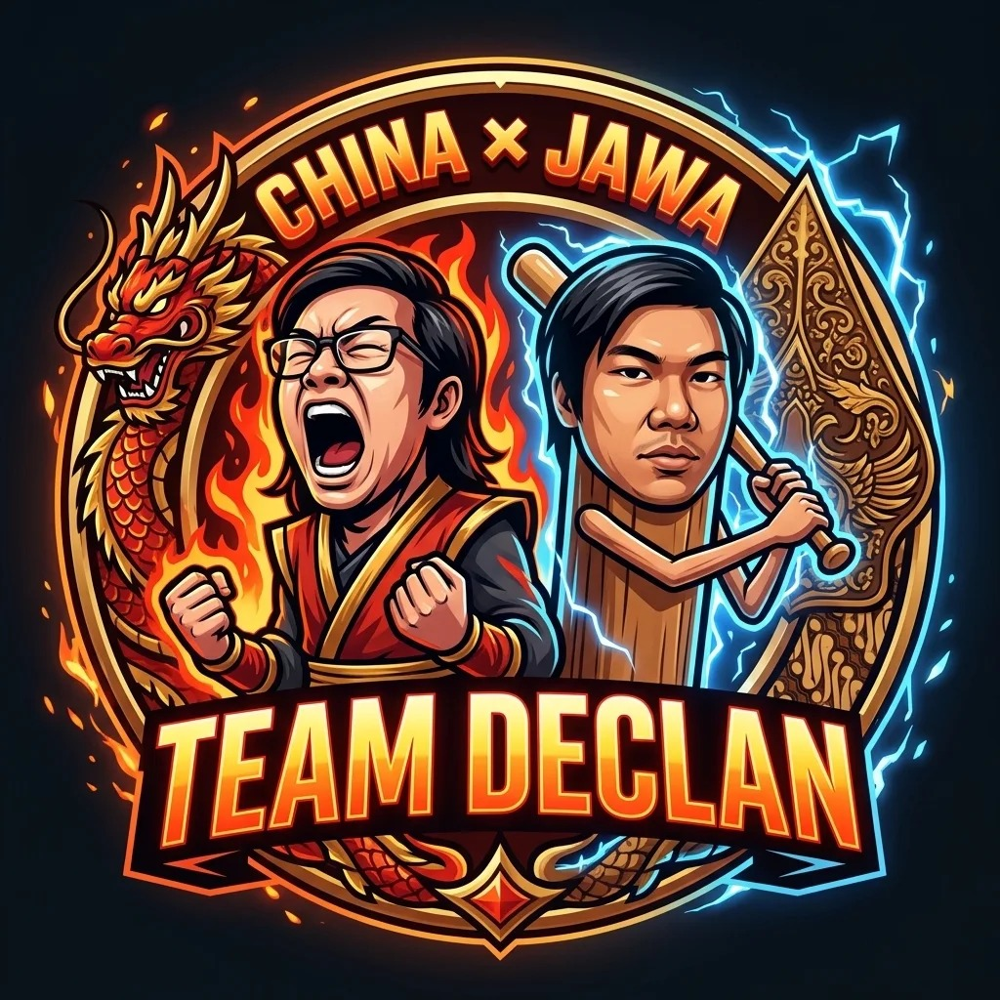

<div align="center">
  

  <h1>DECLAN</h1>
  <p><strong>Satu Tim. Banyak Arena.</strong></p>
  <p>Tim kompetisi multidisiplin dari Semarang × Yogyakarta</p>

  <p>
    <a href="https://declan-xi.vercel.app/">
      
    </a>
  </p>

  <p>
    
    
    
    
  </p>
</div>

---

## Tentang DECLAN

DECLAN mempertemukan orang-orang dengan keahlian berbeda untuk belajar,
berkarya, dan berkompetisi bersama. Bukan hanya tim gaming—kami menjelajahi
**web development, ethical hacking/CTF, esports, dan creative technology**.

| Arena | Fokus |
|---|---|
| 🌐 **Web development** | Merancang dan membangun pengalaman web |
| 🛡️ **Cybersecurity** | Belajar keamanan melalui lab dan kompetisi CTF yang berizin |
| 🎮 **Esports & gaming** | Strategi, komunikasi tim, latihan, dan turnamen |
| 🎨 **Creative tech** | UI/UX, desain, dan prototipe digital |

> **Prinsip kami:** penasaran, terus belajar, bermain adil, dan bertanggung jawab.
> Pengujian keamanan hanya dilakukan pada lab, CTF, atau sistem yang secara
> eksplisit memberikan izin.

## Jelajahi website

**[declan-xi.vercel.app →](https://declan-xi.vercel.app/)**

Website ini adalah landing page portofolio yang memperkenalkan cerita, cabang
kompetisi, tim inti, perjalanan, merchandise, dan cara menghubungi DECLAN.

### Yang ada di dalamnya

- Hero interaktif dengan navigasi ke bagian penting.
- Profil enam anggota dan bidang keahlian tim.
- Timeline perjalanan kompetisi.
- Katalog merchandise dan lookbook dengan lightbox.
- Formulir minat untuk calon anggota.
- Layout responsif, navigasi keyboard, dan dukungan `prefers-reduced-motion`.

## Teknologi

- **HTML** untuk struktur dan konten.
- **CSS** untuk layout responsif, tema visual, dan animasi.
- **JavaScript vanilla** untuk navigasi, animasi angka, lightbox, dan interaksi.
- Font lokal **Anton** dan **Sora**; tidak ada framework, dependency, atau build
  step yang diperlukan.

## Jalankan secara lokal

### Dengan Laragon

1. Buka Laragon dan pilih **Start All**.
2. Kunjungi `http://localhost/declan/`.

### Dengan Python

Dari folder proyek, jalankan:

```powershell
py -m http.server 8000
```

Kemudian buka `http://localhost:8000/`. Bisa juga membuka `index.html` langsung,
tetapi server lokal biasanya lebih konsisten untuk memuat font dan aset.

## Struktur proyek

```text
declan/
├── index.html                 # konten dan struktur halaman
├── README.md
├── .htmlvalidate.json         # aturan validasi HTML
└── assets/
    ├── css/
    │   └── main.css           # tema, layout, animasi, dan breakpoint
    ├── js/
    │   └── main.js            # perilaku dan interaksi halaman
    ├── fonts/                 # font lokal Anton dan Sora
    └── img/                   # logo, ikon, foto produk, dan gambar sosial
```

## Kustomisasi cepat

| Ingin mengubah | Lokasi |
|---|---|
| Judul, deskripsi, metadata, dan konten halaman | `index.html` |
| Cabang, profil tim, dan timeline | `index.html` — bagian terkait |
| Produk dan gambar | `index.html` — bagian `#merch` dan `#lookbook` |
| Warna, tipografi, layout, dan responsive breakpoint | `assets/css/main.css` |
| Menu, animasi, lightbox, dan formulir demo | `assets/js/main.js` |

## Catatan sebelum dipublikasikan

Konten nama anggota, statistik, cerita, timeline kompetisi, alamat, kontak, dan
produk pada situs ini merupakan **materi demo/portofolio**. Tinjau dan ganti
dengan informasi yang sudah dikonfirmasi sebelum digunakan sebagai profil resmi.

Formulir minat saat ini hanya demonstrasi: **data tidak disimpan atau dikirim ke
server**. Tautan sosial yang masih `#` juga perlu diganti dengan URL resmi.

---

<div align="center">
  Dibuat dengan rasa ingin tahu, kerja sama, dan semangat kompetisi.
  <br>
  <strong>DECLAN · Semarang × Yogyakarta</strong>
</div>
